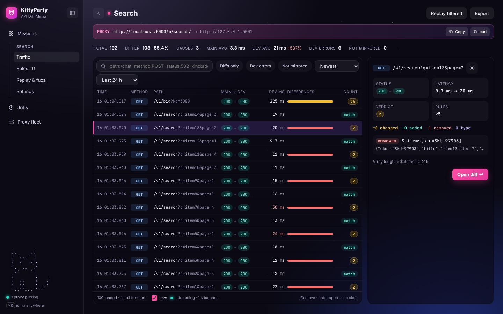

# API Mirror & Diff

Send real traffic through a proxy to your production API (**Main**), mirror it out of band to a candidate (**Dev**), and see every difference: status codes, latency, array lengths and field-level changes with JSON paths. Comparison rules are configurable per mission.

Everything is organised in **missions**. A mission has a Main URL, a Dev URL and a proxy endpoint `http://<proxy>/m/{slug}/…`.

The UI is **KittyParty** (design direction A, "Nebula Console"): dark, dense, keyboard-friendly, with the kitty in the corner.

Read [`docs/ARCHITECTURE.md`](docs/ARCHITECTURE.md) for the services, data flow and how production safety is guaranteed.

## Quick start (docker compose)

```bash
docker compose up --build                    # postgres, api, proxy, web, mcp
docker compose --profile demo up --build     # + two sample upstreams and a seeded "demo" mission
```

| URL | Service |
|---|---|
| http://localhost:8080/m/{slug}/… | **proxy**: point clients here instead of Main |
| http://localhost:8081/api/… | **api** |
| http://localhost:3000 | **web**: the KittyParty UI (nginx; `/api` is proxied to the api) |
| http://127.0.0.1:8090/mcp | **mcp**: MCP server for AI assistants and local LLMs (loopback only) |

With the demo profile:

```bash
curl "http://localhost:8080/m/demo/v1/search?q=lamp&page=2"      # forwarded to Main, mirrored to Dev
curl "http://localhost:8081/api/missions"                          # find the demo mission id
curl "http://localhost:8081/api/missions/<id>/logs?verdict=mismatch&limit=20"
```

Postgres data lives in the `pgdata` named volume; export files in `exports`.

## Creating a mission

```bash
curl -X POST localhost:8081/api/missions -H 'content-type: application/json' -d '{
  "slug": "orders", "name": "Orders API",
  "mainUrl": "https://orders.prod.internal", "devUrl": "https://orders-v2.dev.internal",
  "sampleRate": 0.1,
  "mirrorMethods": ["GET", "HEAD"],
  "headerPolicy": { "strip": ["authorization", "cookie"], "set": { "x-api-key": "dev-key" } },
  "comparedHeaders": ["content-type", "cache-control"],
  "retentionDays": 14, "maxStorageMb": 20000
}'
```

* Only **GET/HEAD** are mirrored by default. Enabling POST/PUT/PATCH/DELETE requires `"acknowledgeUnsafeMethods": true` and the mission then carries a warning, because those requests replay real writes against Dev.
* `sampleRate` is the fraction of eligible requests that are mirrored. Request bodies larger than `maxMirrorBodyBytes` (default 256 KB) are forwarded normally and logged as **not mirrored**.
* `headerPolicy.strip` headers are removed before calling Dev and `set` headers are added or overridden. Authorization, Cookie, Set-Cookie and API-key headers are stored as `[redacted]` in the log unless `Mirror__StoreSensitiveHeaders=true`.

## Rules

Rules run in order before comparison. Each type is one class implementing `IDiffRule` (`src/Mirror.Core/Rules`) and is registered in `RuleRegistry`.

| type | config |
|---|---|
| `PrimaryKey` | `{"path":"$.items","key":"sku"}`: match array items by key (nested key paths `meta.id`, composite `keys:[…]`, nested arrays `$.orders[*].lines`) |
| `IgnoreField` | `{"paths":["$..requestId","$.items[*].updatedAt"]}` |
| `SearchAndReplace` | `{"scope":"body","search":"dev\\.host","replace":"prod.host","regex":true}` or `{"scope":"field","path":"$.items[*].id",…}` |
| `IgnoreOrder` | `{"path":"$.tags"}`: compare as a multiset |
| `NumericTolerance` | `{"path":"$..price","tolerance":0.01,"mode":"absolute"\|"relative"}` |
| `IgnoreHeader` | `{"headers":["date","x-request-id"]}` |
| `TypeCoercion` | `{"path":"$.total"}`: `"1" == 1`, `"true" == true` (no path = everywhere) |

Paths: `$`, `.name`, `['name']`, `[n]`, `[*]`, `.*`, `..name`.

```bash
curl -X PUT  localhost:8081/api/missions/<id>/rules -d '{"rules":[…], "rediff": true}' -H 'content-type: application/json'
curl -X POST localhost:8081/api/missions/<id>/rules/preview -d '{"rules":[…]}' -H 'content-type: application/json'   # effect on recent mismatches
curl localhost:8081/api/rule-types
```

`"rediff": true` starts a background job that re-runs the diff on stored responses without re-sending any requests.

## API overview

| | |
|---|---|
| Missions | `GET/POST /api/missions`, `GET/PUT/DELETE /api/missions/{id}` |
| Rules | `GET/PUT /api/missions/{id}/rules`, `POST …/rules/preview`, `GET /api/rule-types`, `POST /api/rules/validate` |
| Logs | `GET /api/missions/{id}/logs?verdict=&diffKind=&path=&pathMode=prefix\|contains\|exact&method=&mainStatus=&devStatus=&source=&jobId=&signature=&from=&to=&sort=newest\|oldest\|slowest\|most_different&cursor=&limit=` |
| One entry | `GET …/logs/{logId}`, `GET …/logs/{logId}/detail` (headers + full difference list), `GET …/logs/{logId}/body/{request\|main\|dev}?normalized=true` |
| Replay one | `POST …/logs/{logId}/replay` (`?allowUnsafe=true` for writes) |
| Aggregates | `GET …/stats?from=&to=` (per-minute rollup), `GET …/clusters` (mismatches grouped by cause) |
| Live | `GET …/live` Server-Sent Events, at most one batched `logs` event per second |
| Jobs | `POST …/jobs/{rediff\|replay\|fuzz\|export}`, `POST /api/import`, `GET /api/jobs`, `GET /api/jobs/{id}`, `POST /api/jobs/{id}/cancel`, `GET /api/jobs/{id}/download` |
| Export (direct) | `GET /api/missions/{id}/export`: streamed `ndjson.gz` |
| Proxy fleet | `GET /api/proxy/instances` |

All lists use keyset (cursor) pagination. Verdicts: `match`, `mismatch`, `dev_error`, `dev_timeout`, `not_mirrored`. Diff kinds: `status`, `changed`, `added`, `removed`, `type_changed`, `array_length`, `order`, `header`, `body`.

Job examples:

```bash
# replay a filtered subset at 20 req/s
curl -X POST localhost:8081/api/missions/<id>/jobs/replay -H 'content-type: application/json' \
     -d '{"filter":{"verdict":"mismatch","path":"/v1/search"},"ratePerSecond":20,"limit":5000}'
# fuzz from a logged request (or pass "sample": {method,path,query,headers,body})
curl -X POST localhost:8081/api/missions/<id>/jobs/fuzz -H 'content-type: application/json' \
     -d '{"seedLogId":"<logId>","volume":2000,"ratePerSecond":50,"mutations":["null","wrong_type","missing"]}'
# export / import
curl -X POST localhost:8081/api/missions/<id>/jobs/export
curl -o orders.ndjson.gz localhost:8081/api/missions/<id>/export
curl -X POST "localhost:8081/api/import?slug=orders-copy" --data-binary @orders.ndjson.gz
```

Jobs are rows in Postgres. They checkpoint progress, survive restarts (another api instance resumes them) and can be cancelled.

## MCP server (AI assistants and local LLMs)

`src/Mirror.Mcp` is a complete [Model Context Protocol](https://modelcontextprotocol.io) server, `kittyparty-mcp`. With it an assistant can triage a mission, read request diffs and bodies, preview and add rules, replay and fuzz requests, and check whether Dev is ready to replace Main. It is written to work well with small local models (Ollama, LM Studio, Open WebUI, Jan, …): short text results, missions looked up by name, forgiving arguments, errors that say what to do next, and a read-only mode.

* Transports: stdio, Streamable HTTP (`/mcp`) and legacy SSE (`/sse`). Protocol versions 2025-06-18, 2025-03-26 and 2024-11-05.
* 23 tools (13 read-only), resources for missions, rules, causes, stats and request diffs, 3 prompts (`triage_mission`, `tune_rules`, `release_check`), completions and logging.

```bash
dotnet publish src/Mirror.Mcp -c Release -o ./bin/mcp
KITTYPARTY_API_URL=http://localhost:8081 dotnet ./bin/mcp/kittyparty-mcp.dll --stdio            # for a client that starts it
dotnet ./bin/mcp/kittyparty-mcp.dll --http --port 8090 --api-url http://localhost:8081 --read-only  # shared HTTP server
```

Client configs (LM Studio, Ollama clients, Open WebUI, Continue, Claude Desktop, …), the tool list and tips for local models are in [`docs/MCP.md`](docs/MCP.md).

## Configuration

Everything is environment variables. The main ones:

| variable | default | service |
|---|---|---|
| `ConnectionStrings__Postgres` | `Host=localhost;Database=mirror;Username=mirror;Password=mirror` | proxy, api |
| `Mirror__QueueCapacity` | 10000 | proxy: bounded mirror queue (full ⇒ drop) |
| `Mirror__Workers` | 64 | proxy: concurrent Dev calls |
| `Mirror__DiffConcurrency` | cores/4 | proxy: concurrent diff computations |
| `Mirror__MaxCapturedResponseBytes` | 8 MB | proxy: larger Main responses are not mirrored |
| `Mirror__MaxInFlightCaptureBytes` | 256 MB | proxy: global capture memory budget |
| `Mirror__MaxDiffBodyBytes` | 16 MB | proxy: larger bodies are compared byte-for-byte only |
| `Mirror__StoreBodies` / `Mirror__StoreSensitiveHeaders` | true / false | proxy |
| `Mirror__LogBatchSize` / `Mirror__LogFlushIntervalMs` | 500 / 1000 | proxy: COPY batching |
| `Mirror__ConfigRefreshSeconds` | 5 | proxy: config poll interval |
| `Mirror__UseSystemProxy` / `Api__UseSystemProxy` | false | route outbound calls to Main/Dev through `HTTPS_PROXY` (egress proxies) |
| `Mirror__SnapshotFile` | (unset; `/var/cache/mirror/snapshot.json` in the image) | proxy: config used on cold start if Postgres is down |
| `Mirror__DevBreaker*` | 0.5 ratio / 20 min / 30 s window / 30 s break | proxy: circuit breaker |
| `Api__MigrateOnStartup` | true | api (`--migrate-only` runs migrations and exits) |
| `Api__ExportDir` | `/data/exports` | api |
| `Api__MaxConcurrentJobs` | 4 | api |
| `Api__ProxyPublicUrl` | `http://localhost:8080` | api: proxy base URL shown in the UI |
| `Api__CorsOrigins__0` | | api (only for running the UI from another origin) |
| `API_UPSTREAM` | `http://api:8080` | web |

## Health and metrics

* Every service: `GET /healthz` (liveness) and `GET /readyz` (readiness). The proxy is ready once it has a config snapshot, and it **stays ready if Postgres goes away**.
* Proxy Prometheus metrics at `/metrics`: `mirror_queue_depth`, `mirror_dropped_total{reason}`, `mirror_not_mirrored_total{reason}`, `dev_requests_total{mission,outcome}`, `dev_request_duration_seconds`, `main_request_duration_seconds{mirrored}`, `dev_circuit_state{mission}`, `log_records_written_total`, `log_records_dropped_total{reason}`, `mirror_capture_bytes`, `config_snapshot_age_seconds`. There is a JSON snapshot at `/metrics/json`, and the same data is written to `proxy_instances` for the UI.

## Kubernetes

Manifests are in `deploy/k8s` (kustomize): namespace, ConfigMap/Secret, Postgres StatefulSet with a PVC, a migration Job, api (with an export PVC), proxy (3+ replicas, HPA, PDB, spread across nodes), web and the MCP server (read-only, no Ingress), plus an example Ingress.

```bash
# build and push images (context = repo root)
docker build -f deploy/docker/api.Dockerfile   -t <registry>/mirror-api:<tag>   .
docker build -f deploy/docker/proxy.Dockerfile -t <registry>/mirror-proxy:<tag> .
docker build -f deploy/docker/web.Dockerfile   -t <registry>/mirror-web:<tag>   .
docker build -f deploy/docker/mcp.Dockerfile   -t <registry>/mirror-mcp:<tag>   .

# set images in deploy/k8s/kustomization.yaml and secrets in deploy/k8s/config.yaml, then
kubectl apply -k deploy/k8s
kubectl -n api-mirror wait --for=condition=complete job/mirror-migrate --timeout=5m
```

On each release, delete and re-apply `job/mirror-migrate` before rolling out the api. The proxy's `preStop` uses the native `sleep` action (Kubernetes ≥ 1.30). The export volume is ReadWriteOnce with one api replica. To run several api replicas, use a ReadWriteMany storage class.

## Development

Everything targets **.NET 8** (LTS). `global.json` pins the .NET 8 SDK (any 8.0 feature band); the solution is `Mirror.sln`. The frontend needs Node 20+.

```bash
dotnet test                     # xUnit: diff engine, every rule type, fuzz generator, codec, proxy safety tests, MCP server
(cd web && npm ci && npm test)  # vitest: side-by-side alignment, folding, key matching, search syntax, rule suggestions
(cd web && npm run dev)         # UI on http://localhost:5173, proxies /api to http://localhost:8081 (API_URL to change)
dotnet run --project src/Mirror.Api      # needs Postgres; migrates on start
dotnet run --project src/Mirror.Proxy
VARIANT=main ASPNETCORE_URLS=http://localhost:5001 dotnet run --project src/Mirror.TestUpstream
VARIANT=dev  ASPNETCORE_URLS=http://localhost:5002 dotnet run --project src/Mirror.TestUpstream
```

Load test: see [`loadtest/README.md`](loadtest/README.md). In the development run, 10 % mirroring added ~0 ms at p50 and ~1 ms at p99 compared to the same proxy without mirroring.

| path | |
|---|---|
| `src/Mirror.Core` | diff engine, JSON path matcher, rules, fuzz generator, codecs. No I/O |
| `src/Mirror.Data` | EF Core context + migration, partitioned log schema, COPY writer, keyset queries |
| `src/Mirror.Proxy` | proxy service |
| `src/Mirror.Api` | api service (endpoints, jobs, maintenance, SSE) |
| `src/Mirror.Mcp` | MCP server for AI assistants and local LLMs (see `docs/MCP.md`) |
| `src/Mirror.TestUpstream` | deterministic JSON upstream for demos and load tests |
| `web/` | KittyParty UI: React + TypeScript + Vite, TanStack Query/Virtual, diff Web Worker |
| `deploy/` | Dockerfiles, nginx config, k8s manifests, demo seed |

## Frontend (KittyParty)



`web/` is React 18 + TypeScript + Vite. TanStack Query handles server state and TanStack Virtual handles long lists. The production build is served by nginx.

| Screen | What it does |
|---|---|
| **Missions** | Fleet KPIs (mirrored volume, mirroring cost on the main path, drops, Dev errors), filters (needs attention, mirrors writes, paused), a 24 h diff-rate sparkline and rule count per mission, plus create/edit/delete. |
| **Traffic** | Proxy endpoint with copy/curl buttons, a stats strip, and a virtualized, infinitely scrolling log filtered and sorted on the server. The search box understands `path:` `method:` `status:` `kind:` `verdict:` `source:` `job:`. Each row has a coloured bar showing the mix of changed/added/removed/type differences. The side panel groups mismatches **by cause**, with one-click rule suggestions; selecting a request opens an inspector there instead. |
| **Request diff** | Full-height side-by-side view. Both bodies are fetched and aligned **in a Web Worker**, structure-aware and matching arrays by the mission's primary-key rules, so multi-MB JSON stays responsive: a 5.8 MB / 384k-line response aligns in about 0.4 s. Unchanged runs are folded and expand on click. Lines that differ but are excluded by rules are dimmed. A list of every difference jumps to the line (`n`/`N`). Also: Headers, Request (copy as curl), Replays, `[`/`]` for the previous/next request, Replay & compare. |
| **Rules** | Ordered list (drag, up/down, enable), a typed editor per rule type with server-side validation, a JSON view, a **live preview** of the draft on recent traffic (now / after / newly matching), and Save with an optional background re-diff. Suggestions from other screens arrive as unsaved drafts. A summary of the mission's mirroring settings is included. |
| **Replay & fuzz** | Start replay-all (filters, rate, limit), fuzz runs (seed request or sample, mutation families, rate), export (streamed or as a job) and re-diff, and follow their progress. |
| **Jobs / Proxy fleet** | All jobs with progress, cancel, download and result summaries, plus import upload. Every proxy's queue, drops, log writer, main-path latency (mirrored vs not) and circuit-breaker state. |

Live updates use Server-Sent Events. New rows are prepended at most once per second, only if they match the current filters. While you are scrolled down they collect behind a "↑ N new" pill instead of moving the list. `⌘K` / `Ctrl+K` jumps to any mission or page.

Writing to Dev is never one click away. Turning on POST/PUT/PATCH/DELETE mirroring asks for confirmation (and the api requires `acknowledgeUnsafeMethods`), and replaying or fuzzing write methods needs an explicit opt-in.
